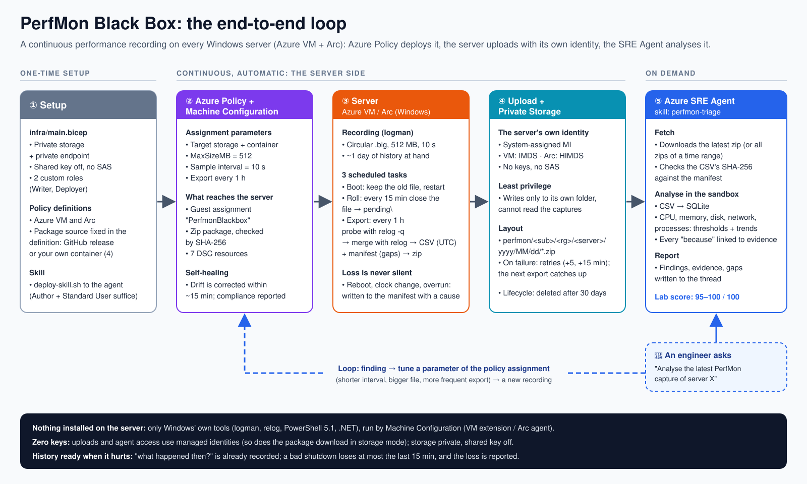

# perfmon-blackbox: ask the SRE Agent why a Windows server was slow, any time

**Ask the Azure SRE Agent about a server and get a ranked performance report of its latest hours**: what made it hard
to use, when, for how long, which process drove it, what is leaking, what is fine, and what to do next. The agent's
skill fetches the server's latest PerfMon capture from your storage and analyses it with fixed rules (no raw data, a
verdict ceiling, no cause without a test in time). The captures come from a black-box recorder that Azure Policy keeps
running on every Azure VM and Arc-enabled server: collection is the input, **the analysis is the value**.

> Not an official Microsoft product. Working and versioned, no support promise. See the
> [repo README](../../README.md).

**Status: v1.0.1** ([release](https://github.com/VezirOrg/sreagent-playbook/releases/tag/perfmon-blackbox/v1.0.1), package `PerfmonBlackbox.zip`, SHA-256 `806BCADB69F55640…`,
the same zip as v1.0.0; v1.0.1 fixes the policy definitions and the deploy docs: [CHANGELOG](CHANGELOG.md)). Tested end to
end on an Azure VM and an Arc-enabled server ([docs/tests.md](docs/tests.md)). The `v1.0.0-rc.N` pre-releases were lab
test builds; do not use them.

## What it does

- An **Azure Machine Configuration** package (`PerfmonBlackbox`, AuditAndSet) keeps a PerfMon Data Collector Set
  running on every targeted server, as a **binary circular log** (default 512 MB, sampled every 10 s), and restarts it
  after every reboot. The last `MaxSizeMB` of data is always on the disk.
- Every `ExportEveryHours` (default 1; 4 up to v1.0.1) a scheduled task exports the window **since the last successful export** (no
  gap, no overlap) to CSV, zips it with a `manifest.json`, and uploads it with the **server's own managed identity**
  into **its own folder** of **your private storage account**. A server cannot write anywhere else, and cannot read the captures.
- Any loss (the ring overwrote data before an export, the machine was off, the collector restarted, the local cap
  dropped data) is **written into the manifest** (`gaps[]`, `complete: false`) and the event log. Never silent.
- If a server's buffer cannot hold the export window (many processes, short interval, small buffer), the guest
  assignment turns **NonCompliant** with the numbers in its reason, before data is lost.
- Azure Policy definitions (DeployIfNotExists): `perfmon-blackbox-vm` for Azure VMs and `perfmon-blackbox-arc`
  for Arc-enabled servers, which take the package from the GitHub release, and `-vm-storage` / `-arc-storage`, which
  take it from your own container ([deploy.md](docs/deploy.md)). Assign the one(s) you need.
- The SRE Agent skill **perfmon-triage** fetches the latest zip of a server, checks it, converts it to SQLite and
  triages it; the report quotes the zip and every gap.

Nothing is installed on the servers beyond the package's own files: the scripts run in **Windows PowerShell 5.1**
(built in) and use `logman`, `relog`, `schtasks` and .NET only. The Machine Configuration agent runs the package's DSC
resources in its own PowerShell 7, which ships with the agent.

Design: [docs/design.md](docs/design.md). Tests: [docs/test-plan.md](docs/test-plan.md). Decisions:
[decisions.md](decisions.md).

## Counters

A 36-counter PerfMon template (LogicalDisk, Memory, Process ×8, Network Interface, Processor Information, TCP),
plus 12 system-wide counters (G1: queue, context switches, up time, hard faults, paging file, disk idle/queue, …),
2 per-process pool counters (G2), and 6 web counters (G3: ASP.NET, .NET CLR Memory, Web Service) **only where those
counter objects exist** (re-checked every 15 minutes). Files: [package/collector/](package/collector/).

## How long the buffer lasts

A `.blg` costs about 45–54 bytes per value per sample; the per-process counters dominate. Measured on lab servers and
counted on real captures (decisions P27): **bytes per sample ≈ 4.5 KB + 0.53 KB × processes** (full set).

| Processes | KB per sample | Hours in 512 MB at 10 s |
|---|---|---|
| 100 | ≈ 58 | ≈ 26 h |
| 200 | ≈ 110 | ≈ 13.5 h |
| 300 | ≈ 164 | ≈ 9 h |
| 400 | ≈ 216 | ≈ 6.9 h |
| 500 | ≈ 270 | ≈ 5.5 h |

The ring only has to hold 1.5 × 15 minutes (it is closed every 15 minutes) and `LocalKeepMB` (1024 MB, twice the column
above) 1.5 × the export window. With the defaults (10 s, hourly export) both hold well past 500 processes. Otherwise
raise `LocalKeepMB` or `MaxSizeMB`, lengthen the interval or export more often ([parameters.md](docs/parameters.md)).

## Prerequisites

- Windows Server 2016 or later (Azure VM or Azure Arc-enabled server), Windows PowerShell 5.1 (built in).
- Azure VMs: the built-in initiative *Deploy prerequisites to enable Guest Configuration policies on virtual machines*
  (system-assigned identity + the Machine Configuration extension). Arc servers: Connected Machine agent ≥ 1.10.
- Network: every server must reach the storage account's **private endpoint** (DNS `privatelink.blob.core.windows.net`
  resolving to it), and the package: either the GitHub release asset (HTTPS) or, in storage mode, a container in the same
  private storage, downloaded with the server's own identity (no internet needed; [docs/deploy.md](docs/deploy.md)).
- **The SRE Agent needs VNet integration** that can resolve and reach the same private endpoint (its sandbox egress
  in your VNet with private DNS resolution). Without it the skill cannot read the captures.
- Permissions to deploy the storage, create custom roles and policy definitions, and assign roles.
- **One deployment per tenant by default**: the custom role names are unique in the whole Entra tenant, and the policy
  definition names in the subscription. A second deployment passes its own names:
  [docs/deploy.md](docs/deploy.md#names-a-second-deployment-in-the-same-tenant-or-subscription).

## Deploy

Step by step, with every command and role: **[docs/deploy.md](docs/deploy.md)** (storage, the policy definitions, the
rights of the policy identity, remediation, the skill). Use the commands from a clone of this repository at the tag
`perfmon-blackbox/v1.0.1`; the release notes give the package URL and its SHA-256.

## On each server

`C:\ProgramData\PerfmonBlackbox\` (SYSTEM and Administrators only): `bin\` (scripts, counter lists, template),
`blg\` (the live ring), `pending\` (closed rings not yet exported), `outbox\`, `log\`, `config.json`, `state.json`.
Tasks `\PerfmonBlackbox\Boot`, `\PerfmonBlackbox\Roll` (every 15 min) and `\PerfmonBlackbox\Export`. Event log source `PerfmonBlackbox` (1000s info, 2000s data
loss, 3000s errors). Captures live at `perfmon/<subscriptionId>/<resourceGroup>/<server>/<yyyy>/<mm>/<dd>/` in storage.

## Cost

Azure VM ≈ 0.01–0.03 USD a month (storage); Arc server + 6.00 USD a month (Machine Configuration on Arc); ≈ 7.30 USD a
month per deployment (private endpoint). The SRE Agent is billed separately: its always-on flow is 4 AAU per hour
(≈ 0.44 USD an hour, ≈ 320 USD a month, while the agent exists), plus active flow for each analysis. Details and price
source: [docs/cost.md](docs/cost.md).

## Documentation

| Doc | For |
|---|---|
| [docs/analysis.md](docs/analysis.md) | **what the agent tells you**: how to ask, the steps, the report, rules and limits |
| [docs/architecture.md](docs/architecture.md) | how it fits together (diagram) |
| [docs/deploy.md](docs/deploy.md) | deploying it |
| [docs/parameters.md](docs/parameters.md) | parameters, buffer hours, the capacity check |
| [docs/operations.md](docs/operations.md) | upgrades, troubleshooting, removal, [how it works on the server](docs/operations.md#how-it-works-on-the-server) |
| [docs/security.md](docs/security.md) | identities, roles, the prefix condition, what runs on servers |
| [docs/cost.md](docs/cost.md) | cost per server and per deployment |
| [docs/tests.md](docs/tests.md) | every test and its status |
| [docs/load-generation.md](docs/load-generation.md) | how the lab plants problems for the end-to-end test |

## Remove

See [docs/operations.md](docs/operations.md#remove).
