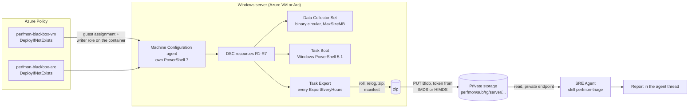

# Architecture

> **Summary.** Two parts. **The analysis** (the value): ask the SRE Agent about a server; its skill fetches the
> server's latest capture, analyses it and writes a ranked report with times, drivers and recommendations
> ([analysis.md](analysis.md)). **The collection** (the input): Azure Policy installs a Machine Configuration package
> that keeps a binary circular PerfMon log running on every targeted Windows server and exports it every few hours to
> private storage, with the server's own identity, into its own folder. Nothing is installed on the servers.
>
> As of v1.0.1.


*Azure Machine Configuration* was formerly called guest configuration (the name lives on in identifiers such as
`Microsoft.GuestConfiguration`). It is the current service and replaces Azure Automation State Configuration (retiring
2027-09-30) and the DSC extension
([Learn](https://learn.microsoft.com/azure/governance/machine-configuration/whats-new/migrating-from-azure-automation)).

## What you get

```text
You:   Analyse the latest PerfMon capture of vm1.
Agent: Capture: vm1_20261011-134118_20261011-145348.zip, complete, 10 s, 436 samples.
       1 CPU   100% at 13:52:28, 11.8 min (13:51:58–14:03:38), driver bbcpu        critical
       5 Leak  bbleak Private Bytes 64 MB → 816 MB (643 MB/h) over 70 min          warning
       Fine: disk, network, paging file, PTEs. Next: identify the bb* processes.
```

(Condensed from a lab report: [analysis.md](analysis.md) has the verbatim excerpt.)

## Picture



ASCII, for viewers without mermaid:

```
 Policy (VM) / Policy (Arc) --DINE--> guest assignment PerfmonBlackbox + Writer role (ABAC: own prefix only)
                                           |
 Server:  Machine Configuration agent ---> R1 files+config  R2 collector  R3 running  R4 boot task  R5 export task  R6 capacity  R7 roll task
          Data Collector Set (binary circular, MaxSizeMB) <- Boot task (start, keep old ring as pending)
          Roll task (every 15 min): stop -> move ring to pending\ -> start   (closed pieces of <= 15 min)
          Export task: roll -> relog each piece -> one CSV window since last export -> zip + manifest
                         -> token (IMDS on Azure VMs, HIMDS on Arc) -> PUT Blob -> state.json moves forward
                                           |
 Storage (private endpoint, no keys):  perfmon/<sub>/<rg>/<server>/<yyyy>/<mm>/<dd>/<server>_<from>_<to>.zip
                                           |
 SRE Agent (VNet integrated): perfmon_fetch_latest.py -> CSV -> SQLite -> triage -> report
```

## The parts

| Part | Where | What |
|---|---|---|
| Two policy definitions | `policy/build_policies.py` | DINE: the guest assignment, and one Writer role assignment per server with an ABAC path condition |
| Package `PerfmonBlackbox` | `package/` | DSC resources R1–R7 (`PerfmonBlackboxDsc`), the collector files, two 5.1 scripts |
| Storage | `infra/main.bicep` | private, no shared key, lifecycle 30 days, the Writer and Deployer custom roles |
| Skill | `skill/perfmon-triage/` | fetch latest zip, convert, triage; quotes gaps and `complete`. Deployed by `scripts/deploy-skill.sh` through the agent's data-plane API, not Bicep: the ARM `Microsoft.App/agents/skills` resource answered "internal tenants only" (P61) |

## Two runtimes on the server

| Code | Runs in |
|---|---|
| DSC resources (R1–R7) | the Machine Configuration agent's own PowerShell 7 (ships with the agent) |
| `Start-PerfmonBlackbox.ps1`, `Export-PerfmonBlackbox.ps1` | Windows PowerShell 5.1, as SYSTEM, from scheduled tasks |

Both use only what ships with Windows: `logman`, `relog`, `schtasks`, `icacls`, .NET, `Invoke-WebRequest`.

## The export, step by step

1. **Roll**: stop the collector, move the ring to `pending\`, start it again (a running circular `.blg` cannot be read;
   the restart costs a few seconds and is measured in every manifest as `roll_seconds`).
2. **Window**: relog every pending ring to CSV, merge them in time order, keep only samples after the last exported one
   (the whole server-side flow with the reason for each step: [operations.md, How it works on the server](operations.md#how-it-works-on-the-server)).
3. **Holes**: every step longer than two intervals becomes a gap with a cause (`buffer_overrun`, `collector_restart`,
   `machine_off`, `local_cap`, `missing_samples`, `unreadable_ring`); `complete` is false if there is any (a roll's own
   few seconds, `export_roll`, do not count).
4. **Zip** the CSV with `manifest.json`; **upload** with the server's identity; only then move `last_ts` forward.

## Why the package source is fixed when the definitions are generated

*Decision P48 (2026-10-11), found in test T18b on the Arc lab server arc1. Times are UTC.*

**What we tried.** One pair of policy definitions, with the package source as an assignment parameter: empty meant the
GitHub release asset, a blob container ID meant "download the same zip from that container with the machine's own
system-assigned identity". The deployment in the definition computed `contentUri` and `contentManagedIdentity` from
that parameter.

**What happened.** With the parameter set to the lab's `packages` container:

| Time | Source | What it shows |
|---|---|---|
| 20:58:37 | activity log | the policy assignment's identity PUTs the guest assignment (storage URI, `contentManagedIdentity: system`) |
| 21:00:40 | agent log on arc1 | `Managed identity provided, generating an authorization header using bearer token …` → `Download assignment package for : PerfmonBlackbox from private blob using managed identity` → `Package downloaded` → `Assignment validated`; the server applies it |
| 21:07:22 | activity log | a **second PUT of the same guest assignment, by a different application** (not the policy identity, not ours) |
| 21:10:42 | agent log on arc1 | `Managed identity not provided, defaulting to sas uri token` → `Download assignment package for : PerfmonBlackbox from public blob` → the GitHub URI |

The download with the machine identity worked; something else put the assignment back to the GitHub source within
minutes.

**Why.** The Machine Configuration service builds the guest assignment from the definition's
`metadata.guestConfiguration`, for AuditIfNotExists and DeployIfNotExists definitions alike
([concepts/assignments](https://learn.microsoft.com/azure/governance/machine-configuration/concepts/assignments),
[create-policy-definition](https://learn.microsoft.com/azure/governance/machine-configuration/how-to/create-policy-definition)).
Policy metadata is static text: it cannot take an assignment parameter. Ours named the GitHub URI and no identity, so the
service's own write won over the deployment's. Microsoft's `New-GuestConfigurationPolicy -UseSystemAssignedIdentity`
does the same thing we do now: it writes the storage URI and `contentManagedIdentity: "system"` into the definition,
both into the metadata and into the deployment. The access options are described in
[5-access-package](https://learn.microsoft.com/azure/governance/machine-configuration/how-to/develop-custom-package/5-access-package).

**So:** the package source is chosen when the definitions are generated. `build_policies.py` without options gives
`perfmon-blackbox-vm` / `-arc` (GitHub). With `--package-container-id <container ID>` it gives `perfmon-blackbox-vm-storage`
/ `-arc-storage`: the storage URI and `system` are literals in both places, and each server gets Storage Blob Data Reader
on that container. Both kinds write the same guest assignment `PerfmonBlackbox`, so **never assign both over the same
machine**. To switch, unassign the old one, assign the new one, then remediate ([deploy.md](deploy.md)).

| Fixed when the definitions are generated | An assignment parameter |
|---|---|
| package source: GitHub release asset, or your package container (with the system identity) | `StorageAccountResourceId`, `ContainerName` (where the captures are uploaded) |
| `contentHash` (the release's SHA-256) and the package version | `MaxSizeMB`, `SampleIntervalSeconds`, `ExportEveryHours`, `LocalKeepMB` |
| | `WriterRoleDefinitionId` |

The upload storage *can* be a parameter: the configuration parameters (`configurationParameter`) are resolved from the
assignment. Only the metadata fields that say where the package comes from and how it is fetched have to be fixed.

**Two more traps on the way**, both silent:

- **The API version drops the identity.** The guest assignment was created with `apiVersion 2022-01-25`.
  `contentManagedIdentity` exists only from `2024-04-05`
  ([change log](https://learn.microsoft.com/azure/templates/microsoft.guestconfiguration/change-log/guestconfigurationassignments)).
  With the older version ARM accepted the property and dropped it without an error. The agent logged
  `Managed identity not provided, defaulting to sas uri token`, and the private storage answered
  `409 Public access is not permitted on this storage account`. Fixed by using 2024-04-05; a local test checks the
  version.
- **`az role assignment create` does not update a condition.** The policy identity may assign roles on the storage
  account only through a delegation condition (Writer role only). Storage mode also needs Storage Blob Data Reader, so
  the condition gained that role. Re-running `az role assignment create` with the new condition returned the existing
  assignment unchanged, with the old condition. The per-server reader grant then failed ("does not have permission to
  perform action roleAssignments/write"), and the agent got `403 This request is not authorized to perform this
  operation using this permission`. Fix: compare the condition and `az role assignment update` it in place; deploy.md
  warns anyone who upgrades.

**No SAS, shared key disabled.** No SAS token is used anywhere: not for the package, not for uploads, not as a fallback.
Every download and upload uses an Entra ID token: the machine's system identity (IMDS on Azure VMs, HIMDS on Arc) or the
operator's `az … --auth-mode login`. The storage account has shared key access disabled and public network access off.
Tests: T14 (storage settings), T18f (the whole chain with shared key disabled), T18b/T18c (package from storage on Arc
and on an Azure VM).

Details: [design.md](design.md), decisions in [../decisions.md](../decisions.md).
